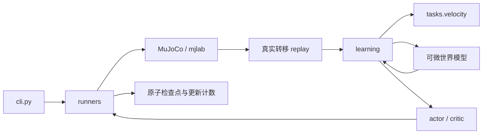

# SuperMimic_Lg 训练核心重构

本轮以 `E:/足式机器人/SuperMimic/代码` 中的本地快照为依据，重构 `E:/SuperMimic_Lg`。不把人形动作跟踪的成绩当作 LgDog 无参考速度控制的成绩。重构前的未提交修复和训练产物保留，源码快照为 `build/pre_refactor_20261112.zip`。

## 学习来源与取舍

| 本地实现 | 本轮采用的设计 | 适配边界 |
|---|---|---|
| SuperMimic-Reproduced_CuboiLeo | rollout / objective / learner 分离；软终止的 GAE；actor 损失除以 horizon；冻结模型但保留输入梯度 | 不沿用 G1 固定切片、身体列表和动作库 |
| xmimic-main/xmimic-main | 独立 WM / policy batch；分数 UTD；critic 先更新归一化再生成固定目标；actor beta2=0.95 与逐元素梯度裁剪 | 保留 PyTorch；没有引入 JAX、多 GPU 布局、Muon 或人形 motion encoder |
| Uni-SuperMimic_Motphys | 环境/任务接口与学习组件分离；回放显式处理回合边界 | 不新增 UniLab 依赖 |
| supermimic_vibed_zita-ch | 核对 collect → WM → BPTT → critic 的实际调用与独立批量 | 不新增 Isaac Lab 依赖 |
| trackerlab-supermimic_Renforce | 共用 learner，机器人与 MDP 独立；核对 Go2 四足任务适配方式 | LgDog 继续使用自己的 XML、PD、关节顺序与奖励 |
| supermimic_whole_body_tracking_JackMin7 | 用于核对实验入口与计数 | 本地 `train_mbrl.py` 主循环未见 actor/critic 优化调用，因此没有用作策略更新模板 |

研究文件、快照提交或文件哈希见 [来源清单](validation/2026-11-12_refactor_sources.json)，相关 MIT 许可保留在 [第三方说明](THIRD_PARTY_NOTICES.md)。这些是本地快照；没有声称已检查各项目线上最新版本。

## 新结构

```text
core/supermimic_lg/
  cli.py                    参数校验与任务分发
  checkpointing.py          文件哈希、原子保存与续训合同
  learning/
    rollout.py              注入任务的可微 rollout，不访问仿真器或文件
    returns.py              共享软生存目标与 GAE(lambda)
    optim.py                有限值检查、梯度裁剪、异常安全的参数冻结
    schedule.py             固定采集步数 / 分数 UTD
    velocity.py             可独立调用的 WM 与 actor/critic learner
  tasks/velocity/
    schema.py               张量维度
    mdp.py                  地形、观测、奖励、硬/软终止、足端运动学
    networks.py             世界模型、actor、critic
    replay.py               真实转移、reset 掩码、选择字段采样
    task.py                 可微任务接口：相位推进、观测、奖励、critic 特征
  runners/
    velocity.py             物理采集、训练调度、日志、保存与恢复
    tracking.py             参考动作训练生命周期
  actor_critic.py            tracking 适配器，复用共享数学与优化工具
```



`velocity_task.py`、`scripts/train_velocity.py`、`scripts/train_supermimic.py` 保留兼容导入与旧命令入口。新 console 命令直接指向 `supermimic_lg.cli:main`。

## 数学与更新修正

- 统一时间约定：奖励和终止为 `[H,B]`，`termination[t]` 属于 `s_t→s_{t+1}`；价值为 `[H+1,B]`。tracking 旧接口中的初始终止占位行由适配器去掉。
- Actor 保留 `sum(gamma^t * survival_t * reward_t) + gamma^H * survival_H * V_H` 的梯度。WM 和 critic 的参数被冻结，状态输入的梯度继续回传；异常时恢复每个参数原先的冻结状态。
- GAE 直接使用每步终止概率。原速度实现用两个累计 survival 相除恢复 continuation；长轨迹下两者都下溢到零时，这会把后续 GAE 错当作全部终止。新测试显式覆盖 256 步下溢。
- Velocity critic 的整个 `[H+1,B]` 特征先更新归一化，再计算所有价值和一次固定目标。每个 epoch 复用这些目标，`tensor_split` 覆盖样本余数。
- Velocity actor 默认按 horizon 归一化损失，beta2 改为 0.95，并在全局范数裁剪后增加 0.1 的逐元素裁剪。均可从配置查看或覆盖。这些是有意的算法变更，不声称只移动了文件。
- tracking 默认保留原 actor 损失尺度与更新次数，也可显式使用上述配置。两种任务共用 return/GAE/冻结/优化工具。
- 之前出现策略回归的增量缩放损失仍为实验选项，默认 `--wm-loss-scale fixed`。本轮没有修改观测、奖励数值、动作缩放和物理终止阈值来制造更高回报。

Velocity 默认仍保留奖励范围 ±10 和价值目标范围 ±200；现在这两项明确显示在配置里，可用 `--reward-limit 0 --value-target-limit 0` 关闭。它们不是从论文推导出的四足收敛保证。

## 配置与计数

同步新源码后，在原 CUDA Conda 环境执行 `python -m pip install --no-deps -e .`；安装版本为 0.2.0，随后重新启动工作台。

旧 `--batch-size` 仍可用；独立批量留空时沿用它。工作台新增“模型与策略独立更新（高级）”，可配置两个 batch、UTD、学习率及 critic epochs/minibatches。留空使用任务默认值，点击 4060 预设会清空此前的高级覆盖值。

```bash
python -m supermimic_lg.cli \
  --task velocity --mjlab-root /home/heartpain/mjlab/unitree_rl_mjlab_lgdog \
  --backend mjlab --device cuda:0 --terrain flat --precision bf16 \
  --num-envs 1024 --iterations 10000 --history 3 \
  --wm-batch-size 512 --policy-batch-size 256 --wm-horizon 4 --horizon 16 \
  --update-to-data-ratio 0.4 --wm-updates 5 --policy-updates 1 \
  --warmup-iterations 40 --replay-capacity 64 \
  --command-mode fixed --command-vx 0.4 --command-vy 0 --command-yaw 0 --standing-fraction 0 \
  --wm-loss-scale fixed --max-training-seconds 1200 \
  --output-dir logs/velocity_modular
```

这是便于独立调试的新结构示例，**没有在 4060 上验证收敛或提速**。UTD=0.4 是每轮交替采集 2、3 个控制步；不提供该参数则继续使用 `--collect-steps`。改变采集比例会改变拟合次数与物理数据的比例，不应仅比较“轮数”。

日志新增 `updates/wm`、`updates/actor`、`updates/critic`，分别对应实际 optimizer step。critic 计数包含每个 epoch 的每个 minibatch。每轮记录实际采集步数和独立 batch 大小。完整 learner 配置和计数一起保存；恢复计数不依赖猜测轮数。

## 兼容与迁移

- 网络 state_dict 的键、相同初始权重下的 forward、观测、各奖励项和软终止已对照重构前快照逐项验证，最大容差设为零。
- 旧 velocity actor 仍可观看、独立评估或通过 `--init-policy` 迁移。开启深度时迁移同一份 encoder，避免把旧 actor 接到随机新编码器。
- 新速度训练标记为 `training_revision=5`，包含 learner 配置和更新计数。旧 revision 4 的完整训练状态不能直接冒充 v5 恢复；需新建运行并明确选择 actor 迁移。
- 同一新版运行允许在恢复时调整 `--wm-batch-size` / `--policy-batch-size`，以适应显存；权重、优化器状态及更新计数保留。改变 gamma、任务、网络结构或其余学习合同会被拒绝。
- 同一 UTD 配置按全局迭代数推进，恢复后不会重新从 2、3 序列的开头采集。
- 完整恢复仍会重建物理仿真和 replay；不是逐 bit 恢复整个仿真现场。

## 验证

覆盖共享返回值的数值与解析梯度、软终止下溢、异常恢复冻结状态、critic 固定目标与余数样本、独立批量、实际更新计数、UTD 续训、真实 MuJoCo、深度、旧入口、查看策略和工作台。

16 步 BPTT 的 40 轮真实物理检查采用 8 环境、WM batch 64、policy batch 32、WM 更新 4、policy 更新 1、UTD=0.4、预热 10，累计 800 条转移、WM/actor/critic 更新 156/31/372。它证明较长 rollout 和新调度实际运行，不证明已经学会走路。Windows 本机无可用 CUDA，GPU 编译、BF16 吞吐和 20 分钟达到目标质量均未实测。

最终结果：**64 项全量测试通过**，独立安装包及网页交互检查通过。逐项证据与最后一轮指标见 [验证摘要](validation/2026-11-12_refactor_validation.json)。
